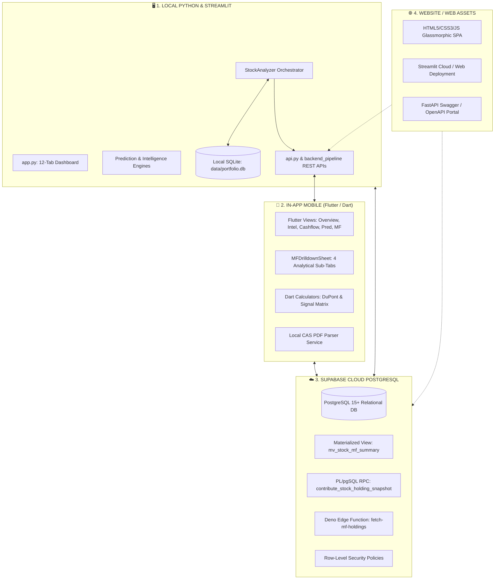
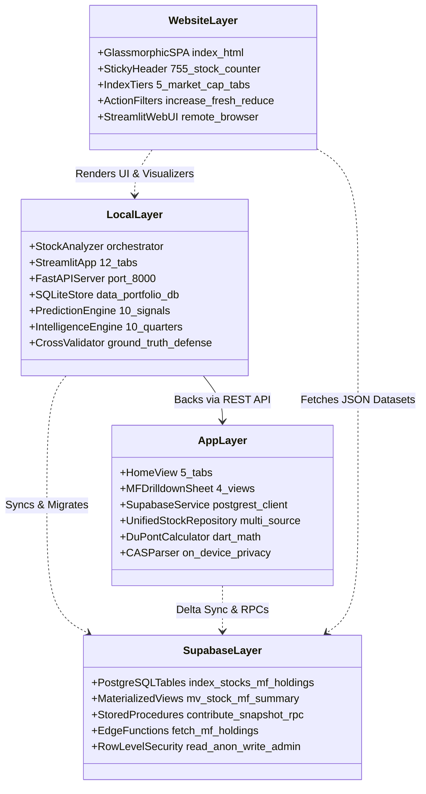
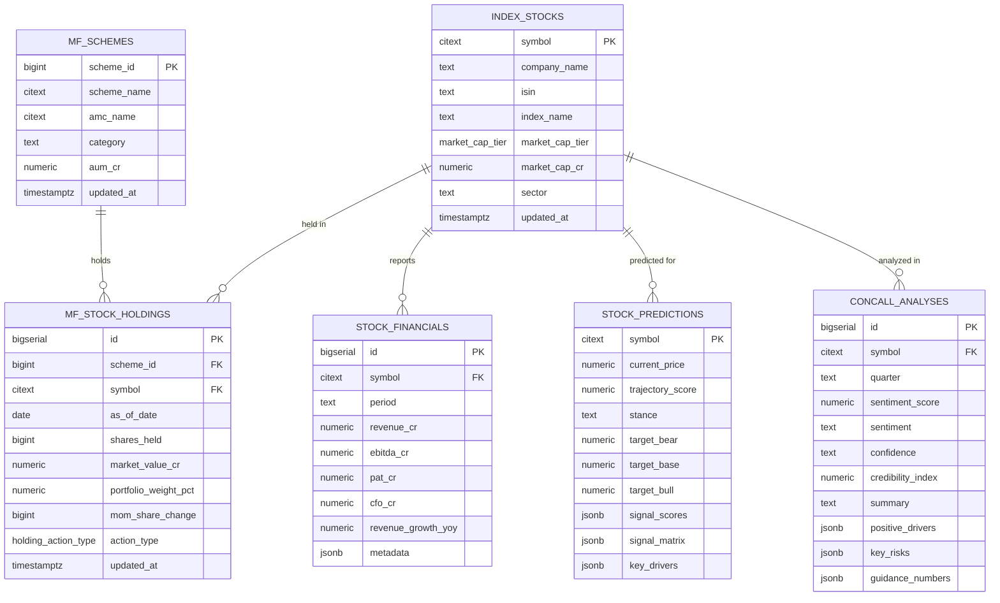
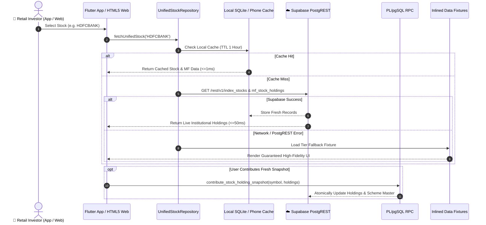
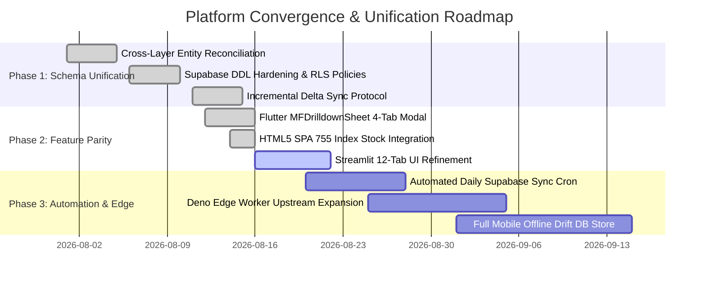

# Comprehensive Feature Documentation & Cross-Layer Mapping Matrix
## Local (Python Engine & Streamlit) ⟷ Mobile App (Flutter) ⟷ Supabase (Cloud PostgreSQL) ⟷ Website (HTML5 Glassmorphic SPA & Web Portal)

> **Document Version:** 3.0.0  
> **Status:** Canonical Master Specification  
> **Domain Focus:** Indian Stock Market Research Platform & Smart Money (Mutual Fund) Holdings Tracker  
> **Ubiquitous Language Authority:** [`CONTEXT.md`](file:///d:/GeoNagrik/Dev/git/stock_market/CONTEXT.md) & [`AGENTS.md`](file:///d:/GeoNagrik/Dev/git/stock_market/.agents/AGENTS.md)

---

## 📑 Table of Contents

1. [Executive Summary & Product Vision](#1-executive-summary--product-vision)
2. [Domain Modeling & Ubiquitous Language Alignment](#2-domain-modeling--ubiquitous-language-alignment)
3. [Architectural Overview of the 4 Target Layers](#3-architectural-overview-of-the-4-target-layers)
4. [Master Feature Comparison Matrix](#4-master-feature-comparison-matrix)
5. [Data Schema & Entity Reconciliation Matrix](#5-data-schema--entity-reconciliation-matrix)
6. [API Endpoints, RPCs & Data Flow Contracts](#6-api-endpoints-rpcs--data-flow-contracts)
7. [Deep-Dive: Layer-by-Layer Feature Audit](#7-deep-dive-layer-by-layer-feature-audit)
   - [7.1 Local Python Engine & Streamlit Dashboard](#71-local-python-engine--streamlit-dashboard)
   - [7.2 In-App Mobile Layer (Flutter & Riverpod)](#72-in-app-mobile-layer-flutter--riverpod)
   - [7.3 Supabase Cloud PostgreSQL & Edge Layer](#73-supabase-cloud-postgresql--edge-layer)
   - [7.4 Website & Web Assets Layer (HTML5 SPA & Web Portal)](#74-website--web-assets-layer-html5-spa--web-portal)
8. [Cross-Layer Differences, Divergences & Gap Analysis](#8-cross-layer-differences-divergences--gap-analysis)
9. [Synchronization, Caching & Fallback Protocols](#9-synchronization-caching--fallback-protocols)
10. [Strategic Convergence Roadmap](#10-strategic-convergence-roadmap)

---

## 1. Executive Summary & Product Vision

The **Indian Stock Market Research Platform** is an institutional-grade stock intelligence and institutional ownership discovery system engineered for Indian retail investors and financial analysts. It tracks the complete **755-stock SEBI/AMFI constituent universe** across five benchmark market capitalization tiers:
- **Nifty 50** & **Nifty Next 50** (Large Cap — Ranks 1 to 100)
- **Nifty Midcap 150** (Mid Cap — Ranks 101 to 250)
- **Nifty Smallcap 250** (Small Cap — Ranks 251 to 500)
- **Nifty Microcap 250** & **BSE Allcap** (Micro Cap — Ranks 501+)

### The Four Target Environments:


---

## 2. Domain Modeling & Ubiquitous Language Alignment

All 4 layers adhere strictly to the canonical domain modeling terminology established in [`CONTEXT.md`](file:///d:/GeoNagrik/Dev/git/stock_market/CONTEXT.md):

| Canonical Domain Term | Precise Definition | Anti-Pattern / Fuzzy Term to Avoid |
| :--- | :--- | :--- |
| **Pure Mutual Fund Ownership %** | Outstanding shares held exclusively by SEBI-registered Asset Management Companies (AMCs). Excludes insurance, banks, and NPS. | Overloaded "DII %" |
| **Total DII Ownership %** | Comprehensive domestic institutional holding under LODR Reg 31, encompassing: Pure MF % + Insurance/LIC % + Pension/NPS % + Banks/Domestic FIs %. | Single undifferentiated "Institutional %" |
| **Free-Float MF Absorption %** | $\frac{\text{MF Shares}}{\text{Total Shares} - (\text{Promoter} + \text{Govt Shares})} \times 100$. Measures institutional float cornering. | Float ownership without promoter adjustment |
| **Active Alpha Scheme** | Actively managed fund (Flexi Cap, Small Cap, Focus) where changes reflect high-conviction manager bets. | Passive ETF holding |
| **Passive Index / ETF** | Rule-based tracking fund (Nifty 50 ETF) where buying is purely SIP/inflow driven with 0 Alpha signal. | Active stock-picking |
| **MoM Net Institutional Drift** | $\Delta \text{Quantity} = \sum \text{Shares}(T) - \sum \text{Shares}(T-1)$ across all disclosing schemes. | Static shareholding |
| **Dominant Action Tag** | Mode action across all holding schemes for a reporting period: `STAKE_INCREASE` (🟢), `FRESH_ENTRY` (🟢), `STAKE_REDUCTION` (🔴), `COMPLETE_EXIT` (🔴). | Generic "Bullish/Bearish" |
| **10-Signal Institutional Matrix** | Multi-factor weighted trajectory score (0–100) combining Fundamentals, Concall Credibility, TAM, Macro, Governance, LODR, Competition, Consensus, SAST, and PEAD. | Simple P/E or moving average signal |
| **Ground-Truth PDF Metric** | Financial numbers extracted directly from statutory Investor Presentation / Result PDFs to cross-validate concall claims. | Unverified LLM summary |
| **Hallucination Defense Badge** | Visual confidence rating (🟢 High $<5\%$ divergence, 🟡 Medium $5-15\%$, 🔴 Low $>15\%$ auto-corrected) generated by `cross_validator.py`. | Unchecked AI text |

---

## 3. Architectural Overview of the 4 Target Layers



---

## 4. Master Feature Comparison Matrix

The table below provides a granular, feature-by-feature comparison across all four layers:

| Feature / Capability | 🖥️ Local (Python / Streamlit) | 📱 In-App (Flutter Mobile) | ☁️ Supabase (PostgreSQL / Edge) | 🌐 Website (HTML5 SPA / Web) |
| :--- | :---: | :---: | :---: | :---: |
| **755 Index Stock Catalog (NSE/BSE)** | ✅ Full SQLite Table | ✅ Dynamic PostgREST + Fallback | ✅ Master `index_stocks` Table | ✅ Full JS Static + Dynamic Dataset |
| **5 Market Cap Tiers (Large to Micro)** | ✅ Multi-tier Filtering | ✅ 5 Swipeable Index Tabs | ✅ `market_cap_tier` ENUM | ✅ 5 Index Filter Buttons |
| **Live CMP & Stock Quotes** | ✅ yfinance + Cache | ✅ YahooService + Repo | ⚠️ Historical & Cap Baseline | ✅ Cached Live Quote Displays |
| **Interactive Price Candlestick + EMAs** | ✅ Plotly (50 & 200 EMA) | ⚠️ Line Summary Preview | ❌ Not stored (Time series) | ⚠️ Lightweight Price Canvas |
| **Financial Statements (P&L, BS, CF)** | ✅ Screener.in 10-Quarters | ✅ PostgREST `stock_financials` | ✅ `stock_financials` Table | ⚠️ Summary Cards |
| **AI Concall Sentiment Analysis** | ✅ Gemini 2.5 + Lexicon Fallback | ✅ Client GeminiService + PostgREST | ✅ `concall_analyses` Table | ⚠️ Pre-rendered Summaries |
| **10-Quarter Intelligence Synthesis** | ✅ Promise Tracking (Delivered/Missed) | ✅ Intelligence Tab Briefing | ✅ Stored in JSONB columns | ⚠️ Intelligence Badges |
| **Credibility Index Scoring (0-100)** | ✅ `intelligence_engine.py` | ✅ Embedded in Intel Card | ✅ `credibility_index` Column | ⚠️ Displayed in Metric Bar |
| **Ground-Truth PDF Metric Extraction** | ✅ PyMuPDF / pdfplumber | ⚠️ Display via REST API | ❌ Documents stored in Index | ❌ Not directly extracted |
| **Hallucination Defense (🟢🟡🔴 Badges)** | ✅ Divergence Auto-Correction | ⚠️ Confidence Status Badge | ✅ `confidence` Field | ⚠️ Confidence Badges |
| **DuPont ROE Decomposition (3/5 Step)** | ✅ Full Forensic Breakdown | ✅ `dupont_calculator.dart` | ✅ Metadata JSONB | ⚠️ Summary Return on Equity |
| **Altman Z-Score & Beneish M-Score** | ✅ Full Solvency/Forensic Scorer | ✅ Distress Badges (Healthy/Alert) | ⚠️ Stored in Financials | ❌ Not displayed |
| **CFO vs PAT Cash Conversion Ratio** | ✅ Cashflow Waterfall Chart | ✅ Visual Audit Cards | ✅ `cfo_cr` vs `pat_cr` Fields | ⚠️ Cash Flow Highlights |
| **10-Signal Trajectory Prediction** | ✅ Multi-factor Prediction Engine | ✅ 10-Signal Trajectory Tab | ✅ `stock_predictions` Table | ⚠️ Trajectory Rating Badges |
| **Scenario Target Bands (Bear/Base/Bull)** | ✅ 12-Month Target Bands | ✅ Visual Target Cards | ✅ `target_bear/base/bull` | ⚠️ Target Range Indicators |
| **Vahan MoRTH EV Sales Tracking** | ✅ Daily & Monthly OEM Regs | ⚠️ REST API `/api/v1/vahan` | ⚠️ Available via API Provider | ❌ Not displayed |
| **Promoter SAST Insider Trading** | ✅ Open Market Buy/Sell Tracker | ⚠️ Integrated into Signal Score | ⚠️ Available via Provider | ⚠️ Smart Money Indicator |
| **MF Institutional Ownership Overview** | ✅ Pure MF % vs Total DII % | ✅ Overview & Drilldown Modal | ✅ `mv_stock_mf_summary` | ✅ Metric Cards & Float Bar |
| **Scheme Master Drilldown (All Funds)** | ✅ Multi-table Breakdown | ✅ `MFDrilldownSheet` (Sorted/Filtered)| ✅ `mf_stock_holdings` Table | ✅ Slide-Up Modal with Schemes |
| **Active Alpha vs Passive ETF Filter** | ✅ Dynamic Classification | ✅ Instant Filter Toggle | ✅ Category column in schemes | ⚠️ ETF vs Equity Badges |
| **AMC Concentration Matrix** | ✅ Plotly AMC Bar Chart | ✅ AMC Aggregated Total Cards | ✅ Aggregated via Group By | ⚠️ AMC Weight List |
| **6-Month Historical MF Drift Trend** | ✅ MoM Share Delta Series | ✅ Accumulation Drift Timeline | ✅ Historical Monthly Rows | ⚠️ 30-Day MoM Change Delta |
| **Crowdsourced Cache-Warming RPC** | ✅ External Ingestion Worker | ✅ `contributeStockHoldingSnapshot` | ✅ `contribute_stock_holding_snapshot` | ❌ Read-Only Client |
| **Incremental Delta Sync Protocol** | ✅ `storage/sqlite_store.py` | ✅ PostgREST `updated_at=gt.` | ✅ `updated_at` Triggers & Indices | ❌ Full JSON Cache Refresh |
| **Personal CAS Portfolio Parser** | ❌ Server-side CAS disabled | ✅ `cas_parser_service.dart` (Local) | ❌ Zero user data stored (Privacy) | ❌ Not available |
| **Offline First / Local Cache Resilience** | ✅ SQLite WAL Mode + FileCache | ✅ Fallback Fixtures + Local DB | ☁️ High-Availability Cloud PG | ✅ Static Inlined JSON Fallback |

---

## 5. Data Schema & Entity Reconciliation Matrix

The table below maps entity names, column types, and object attributes across the four environments:



### Entity Mapping Details:

| Domain Concept | 🖥️ Local SQLite (`storage/sqlite_store.py`) | 📱 Mobile App Dart (`lib/models/`) | ☁️ Supabase PostgreSQL (`docs/supabase_schema.sql`) | 🌐 Website SPA (`index.html`) |
| :--- | :--- | :--- | :--- | :--- |
| **Stock Identity** | `index_stocks` (`symbol`, `company_name`, `tier`, `index_name`, `mcap_cr`, `sector`) | `StockQuote`, `StockMFSummary` (`symbol`, `companyName`, `indexTier`, `mcapCr`) | `index_stocks` (`symbol CITEXT PK`, `company_name TEXT`, `isin TEXT`, `market_cap_tier ENUM`, `market_cap_cr NUMERIC`) | `item` (`name`, `ticker`, `rank`, `cap`, `sector`, `indexName`) |
| **MF Scheme Master** | `mf_schemes_cache` (`scheme_id PK`, `scheme_name`, `amc_name`, `category`, `aum_cr`) | Inlined in `SchemeStockHolding` (`schemeName`, `amc`, `category`) | `mf_schemes` (`scheme_id BIGINT PK`, `scheme_name CITEXT`, `amc_name CITEXT`, `category TEXT`, `aum_cr NUMERIC`) | Inlined in `mfHoldings[]` (`name`, `shares`, `value`, `weight`, `action`) |
| **Scheme Holdings** | `mf_holdings_cache` (`scheme_id`, `symbol`, `as_of_date`, `shares_held`, `market_value_cr`, `portfolio_weight_pct`, `mom_share_change`, `action_type`) | `SchemeStockHolding` (`sharesHeld`, `valueCr`, `weightPct`, `action`, `momDelta`) | `mf_stock_holdings` (`id BIGSERIAL PK`, `scheme_id BIGINT`, `symbol CITEXT`, `as_of_date DATE`, `shares_held BIGINT`, `market_value_cr NUMERIC`, `portfolio_weight_pct NUMERIC`, `mom_share_change BIGINT`, `action_type ENUM`) | `mfHoldings` array (`shares`, `value`, `weight`, `action`) |
| **Financial Statements** | `financial_statements` (`symbol`, `quarter`, `statement_json`) | `FinancialYearData` (`period`, `revenueCr`, `ebitdaCr`, `patCr`, `cfoCr`, `revenueGrowthYoY`) | `stock_financials` (`symbol CITEXT`, `period TEXT`, `revenue_cr NUMERIC`, `ebitda_cr NUMERIC`, `pat_cr NUMERIC`, `cfo_cr NUMERIC`, `revenue_growth_yoy NUMERIC`, `metadata JSONB`) | Aggregated financial metrics in overview cards |
| **Concall Intelligence**| `concall_analysis` (`symbol`, `quarter`, `transcript_url`, `sentiment_json`, `score`, `sentiment`, `confidence`, `summary`, `positive_drivers`, `key_risks`) | `SentimentResult` (`quarter`, `score`, `sentiment`, `confidence`, `summary`, `positiveDrivers`, `keyRisks`, `guidanceNumbers`) | `concall_analyses` (`symbol CITEXT`, `quarter TEXT`, `sentiment_score NUMERIC`, `sentiment TEXT`, `confidence TEXT`, `credibility_index NUMERIC`, `summary TEXT`, `positive_drivers JSONB`, `key_risks JSONB`, `guidance_numbers JSONB`) | Embedded summary bullets & sentiment tags |
| **10-Signal Prediction** | `stock_predictions` (`symbol PK`, `trajectory_score`, `stance`, `current_price`, `target_bear`, `target_base`, `target_bull`, `signal_scores`, `key_drivers`, `governance_flags`) | `PredictionResult` (`trajectoryScore`, `stance`, `targetBear`, `targetBase`, `targetBull`, `signalScores`, `keyDrivers`, `governanceFlags`) | `stock_predictions` (`symbol CITEXT PK`, `trajectory_score NUMERIC`, `stance TEXT`, `target_price_bear NUMERIC`, `target_price_base NUMERIC`, `target_price_bull NUMERIC`, `signal_scores JSONB`, `signal_matrix JSONB`, `key_drivers JSONB`) | Action badges, progress fill bars, trajectory score pill |
| **Sync Watermark** | `sync_metadata` (`table_name PK`, `last_synced_at`, `row_count`) | `lastSyncedAt` timestamp in service state | `updated_at TIMESTAMPTZ` with automatic trigger `update_modified_time()` | Static build timestamp / `date-banner` |

---

## 6. API Endpoints, RPCs & Data Flow Contracts

### 6.1 FastAPI REST Server (`api.py` on Port 8000)
- `GET /api/v1/health` — Service health & version status.
- `GET /api/v1/quote/{symbol}` — Real-time quote, valuation multiples, DuPont ROE, and forensic flags.
- `GET /api/v1/documents/{symbol}` — BSE/Screener/NSE document catalog (transcripts, presentations, PDFs).
- `POST /api/v1/analyze/concalls` — AI concall transcript extraction (accepts `{symbol, max_transcripts, force_refresh}`).
- `GET /api/v1/intelligence/{symbol}` — 10-quarter cross-quarter synthesis, promise tracking, and credibility score.
- `GET /api/v1/cashflow/{symbol}` — Deep cashflow statement audit, CFO/PAT conversion, and Altman Z-score.
- `GET /api/v1/prediction/{symbol}` — 10-signal trajectory score, stance, and scenario price bands.
- `GET /api/v1/vahan` — MoRTH electric vehicle registration records.
- `GET /api/v1/stocks/search?q={query}&tier={tier}` — Full catalog search across 755 index constituents.
- `GET /api/v1/mf/stock-ownership/{symbol}` — Granular mutual fund holding list, scheme count, and MoM changes.
- `GET /api/v1/stocks/market-cap-tier/{tier}` — Stocks filtered by Large, Mid, Small, or Micro cap tier.

### 6.2 AMFI & Holdings Backend Pipeline API (`backend_pipeline/api/main.py`)
- `GET /api/v1/stocks/market-cap-tier?tier={tier}` — Market cap categorized stocks with ownership metrics.
- `GET /api/v1/stocks/{stock_isin}/mf-holdings` — Scheme holding breakdown by stock ISIN.
- `GET /api/v1/mf/buying-trends` — Top most bought stocks across all Indian AMCs this month.
- `GET /api/v1/mf/selling-trends` — Top most sold/trimmed stocks across Indian AMCs this month.
- `GET /api/v1/mf/fresh-entries` — Stocks newly added to mutual fund portfolios ($0 \to >0$).
- `GET /api/v1/mf/exits` — Stocks completely dumped by mutual funds ($>0 \to 0$).
- `GET /api/v1/mf/scheme-mom-diff/{scheme_code}` — Month-over-month holding diff for a specific fund scheme.
- `GET /api/v1/schemes/search?q={query}` — Search AMFI daily master fund directory.
- `GET /api/v1/schemes/{scheme_code}/holdings` — Full underlying stock portfolio for a scheme.
- `GET /api/v1/analytics/overlap?fund_a={code}&fund_b={code}` — Portfolio overlap % and common stocks between 2 funds.

### 6.3 Supabase PostgREST & Cloud RPC Endpoints
- `GET /rest/v1/index_stocks?index_name=eq.{tier}&order=market_cap_cr.desc` — PostgREST stock catalog feed.
- `GET /rest/v1/mf_stock_holdings?symbol=eq.{symbol}&select=*,mf_schemes(...)` — PostgREST granular holdings query with relational joins.
- `GET /rest/v1/stock_financials?symbol=eq.{symbol}&order=period.desc` — PostgREST financial statements.
- `POST /rest/v1/rpc/contribute_stock_holding_snapshot` — Atomic PL/pgSQL crowdsourced cache-warming RPC accepting `(p_symbol TEXT, p_holdings JSONB)`.
- `POST /rest/v1/rpc/refresh_mv_stock_mf_summary` — Concurrent non-locking refresh of materialized view.
- `POST /functions/v1/fetch-mf-holdings` — Deno Serverless Edge Function crawling external disclosures on demand.

---

## 7. Deep-Dive: Layer-by-Layer Feature Audit

### 7.1 Local Python Engine & Streamlit Dashboard

#### Tab Breakdown in `app.py`:
1. **📊 Overview & Chart**: Candlestick price charts with 50-day and 200-day EMAs, business description, 52W high/low, Beta, EV, EV/EBITDA, Forward P/E, PEG ratio, and Book Value.
2. **📑 Financials**: Last 10 quarters scraped from Screener.in, annual Balance Sheets, P&L, and Cashflow statements.
3. **📢 Filings & Docs**: Multi-source document fetcher (BSE $\to$ Screener $\to$ NSE), PDF ground-truth metric extraction, and **Hallucination Defense Cross-Validator** with confidence badges (🟢, 🟡, 🔴).
4. **📰 News**: Curated real-time stock news stream from Google News RSS & Yahoo Finance feeds.
5. **🕷️ Spider Evolution**: 6-factor radar chart (Financial Health, Earnings Growth, Cash Flow Quality, Valuation Attractiveness, Management Credibility, Operational Efficiency) tracking evolution across quarters.
6. **📊 Milestone Tracker**: Timeline of management commitments vs actual outcomes with `DELIVERED`, `IN_PROGRESS`, and `MISSED` tags, computing the historical **Promise Delivery Rate %**.
7. **🧭 Valuation & Thesis**: 3-step/5-step DuPont ROE decomposition, Altman Z-Score bankruptcy prediction, Beneish M-Score manipulation risk, and Discounted Cash Flow (DCF) fair value target bands.
8. **💰 Cashflow Analysis**: CFO/PAT cash conversion audit, Free Cash Flow yield, working capital changes, capex sustainability, and quarterly cashflow waterfall visualizations.
9. **📝 Notes**: Persistent stock notes and investment journal stored locally in SQLite.
10. **🛵 Vahan EV Sales**: MoRTH electric 2-wheeler registration data for OEMs (Ola Electric, TVS Motor, Bajaj Auto, Ather Energy) with daily registration velocity and market share shifts.
11. **🔮 AI Predictor & Screener**: Institutional 10-Signal Matrix forward price trajectory predictions, scenario price bands (Bear, Base, Bull), factor neutralization, and batch screener for 500+ stocks.
12. **🏛️ MF Stock Search & Holdings**: Index constituent explorer, DII/MF holding %, dominant action tags, and interactive scheme drilldown.

---

### 7.2 In-App Mobile Layer (Flutter & Riverpod)

#### Mobile UI Architecture:
- **`HomeView` Scaffold (`views/home_view.dart`)**:
  - Global Search Header with ticker auto-resolution and API Key configuration modal.
  - Dimension synchronization button refreshing all analytical tabs simultaneously.
  - 5-tab scrollable navigation bar.
- **`OverviewTab` (`views/overview_tab.dart`)**:
  - Real-time stock quote card with live CMP, daily change, market cap in ₹ Cr, P/E ratio, 52W range, and business summary.
- **`IntelligenceTab` (`views/intelligence_tab.dart`)**:
  - 10-Quarter AI concall intelligence briefings synthesized from management commentary.
  - Color-coded sentiment badges (🟢 Positive, 🟡 Neutral, 🔴 Negative), confidence ratings, key positive drivers, risk flags, and management guidance numbers.
- **`CashflowTab` (`views/cashflow_tab.dart`)**:
  - Multi-year financial statements table with revenue, EBITDA, PAT, and CFO metrics.
  - CFO/PAT cash conversion ratio calculation and DuPont cash quality badge (`EXCELLENT`, `HEALTHY`, `WARNING`, `ALERT`, `DISTRESS`).
- **`PredictionTab` (`views/prediction_tab.dart`)**:
  - 10-Signal Trajectory score (0–100) and stance badge (`STRONG ACCUMULATION`, `ACCUMULATE`, `NEUTRAL`, `REDUCE`).
  - Live CMP vs 12-Month Scenario Target Price Bands (Bear, Base, Bull) with expected return % calculations.
- **`MFHoldingsTab` (`views/mf_holdings_tab.dart`)**:
  - 5 Index sub-tabs (Nifty 50, Next 50, Midcap 150, Smallcap 250, Microcap 250).
  - Stock cards with market cap in ₹ Cr, sector, Pure MF Ownership %, scheme count, MoM share drift, and action tags (`STAKE_INCREASE`, `FRESH_ENTRY`, `STAKE_REDUCTION`, `COMPLETE_EXIT`).
  - Search field and action filter chips (`ALL`, `STAKE_INCREASE`, `FRESH_ENTRY`, `STAKE_REDUCTION`).
- **`MFDrilldownSheet` (`views/widgets/mf_drilldown_sheet.dart`)**:
  - 4-tab interactive bottom sheet modal:
    1. *Overview*: Dual metric system (Pure MF % vs Total DII 40.14%), Live MF Holding Value ₹ Cr, Free-Float Absorption %, statutory disclosure dates, and domestic tier breakdown.
    2. *All Schemes Master Table*: Searchable scheme catalog with Active Alpha vs Passive ETF filter chips, multi-column sorting (Value, Weight %, Shares, Name), AMC name, fund category, and MoM delta.
    3. *AMC Concentration*: Fund house exposure breakdown (SBI MF, HDFC MF, ICICI Prudential, Nippon India, PPFAS, etc.).
    4. *6-Month Drift Trend*: Visual timeline of institutional share additions and trims.
- **`CASParserService` (`core/services/cas_parser_service.dart`)**:
  - On-device, privacy-first CAMS/KFintech CAS PDF parsing for personal portfolio tracking without uploading investor statements to cloud servers.

---

### 7.3 Supabase Cloud PostgreSQL & Edge Layer

#### Relational Infrastructure (`docs/supabase_schema.sql`):
- **Extensions**: `uuid-ossp`, `pg_trgm` (trigram fuzzy search), `citext` (case-insensitive symbols & names).
- **Core Tables**: `index_stocks`, `mf_schemes`, `mf_stock_holdings`, `stock_financials`, `stock_predictions`, `concall_analyses`.
- **Materialized View**: `mv_stock_mf_summary` computing real-time aggregation across schemes, shares, market value ₹ Cr, net MoM delta, and action type counts.
- **Compatibility Layer**: `stock_concalls` view guaranteeing backwards compatibility for legacy and modern mobile clients.
- **RPC Function (`contribute_stock_holding_snapshot`)**: Atomic `SECURITY DEFINER` procedure validating stock symbols, auto-creating placeholder records, registering missing schemes, and upserting holding snapshots.
- **Edge Function (`fetch-mf-holdings`)**: Deno-based serverless worker handling on-demand crawling for cache misses.
- **Security Hardening**: Strict Row-Level Security (RLS) policies allowing public read access for research data while restricting write operations to `service_role` and secured stored procedures.

---

### 7.4 Website & Web Assets Layer (HTML5 SPA & Web Portal)

#### Web Architecture (`assets/www/index.html` & Streamlit Web):
- **Modern Responsive Dark Theme**: Glassmorphic styling with CSS variables (`--bg: #070a12`, `--surface: #0f172a`, `--card-bg: rgba(30, 41, 59, 0.75)`, `--accent: #38bdf8`).
- **Typography**: Google Fonts `Plus Jakarta Sans` and `JetBrains Mono`.
- **Top Sticky Header**: Brand logo, title, and 755 constituent stock counter badge.
- **Statutory Date Banner**: Statutory disclosure cadence info ("AMFI Monthly Portfolio Jul 31, 2026 & LODR Reg 31 Jun 2026").
- **5 Index Tier Navigation Tabs**: Seamless client-side switching between Nifty 50, Nifty Next 50, Nifty Midcap 150, Nifty Smallcap 250, and Nifty Microcap 250.
- **Action Filter Chips**: Dynamic filtering by `ALL`, `STAKE_INCREASE`, `FRESH_ENTRY`, and `STAKE_REDUCTION`.
- **Stock Card Grid**: Real Market Cap in ₹ Cr, sector, Pure MF Ownership %, Scheme Count, MoM share change delta, progress fill bars, and action badges.
- **Interactive Slide-Up Modal**: Glassmorphic modal with drag handle, close button, scheme master list, shares held, valuation in ₹ Cr, and portfolio weight %.
- **Streamlit Web Portal (`app.py`)**: Full 12-tab research platform deployed for web browsers with Plotly charts and AI tools.

---

## 8. Cross-Layer Differences, Divergences & Gap Analysis

```mermaid
quadrantChart
    title Feature Sophistication vs Deployment Portability
    x-axis Low Portability (Heavy Local) --> High Portability (Any Device)
    y-axis Basic / Aggregated Features --> Advanced Institutional Analytics
    quadrant-1 "Ideal Target: Mobile & Web Parity"
    quadrant-2 "Deep Institutional Core (Local Python)"
    quadrant-3 "Lightweight Web Showcase (Static SPA)"
    quadrant-4 "High-Speed Distributed Edge (Supabase & Mobile)"
    "Local Streamlit Dashboard": [0.15, 0.95]
    "Local Python Orchestrator": [0.10, 0.90]
    "Ground-Truth PDF Extractor": [0.12, 0.85]
    "Vahan Daily EV Scraper": [0.18, 0.75]
    "Flutter Mobile App": [0.82, 0.78]
    "MFDrilldownSheet Modal": [0.85, 0.82]
    "On-Device CAS Parser": [0.90, 0.70]
    "Supabase PostgREST & RPCs": [0.75, 0.65]
    "HTML5 Glassmorphic SPA": [0.95, 0.45]
    "FastAPI REST Endpoints": [0.50, 0.75]
```

### Key Differences & Gaps:

#### 1. PDF Ground-Truth & Hallucination Defense Extraction
- **Local Engine**: Uses `pdfplumber` and `PyMuPDF` to parse multi-page corporate PDFs and compute $>15\%$ divergence flags.
- **In-App Mobile**: Displays confidence badges and auto-corrected results provided by Supabase / REST API, but does not parse raw PDF bytes on mobile due to binary size and memory constraints.
- **Supabase**: Stores structured extraction results and confidence flags in `concall_analyses` and `stock_financials`.
- **Website SPA**: Displays pre-rendered confidence status badges.

#### 2. Machine Learning & LLM Execution
- **Local Engine**: Direct integration with local Ollama (`http://localhost:11434`, FinGPT/Qwen) and Gemini 2.5 Flash with fallback to `lexicon_analyzer.py`.
- **In-App Mobile**: Direct client-side Gemini 2.5 Flash API calls via `GeminiService` and pure Dart mathematical calculators (`DuPontCalculator`, `SignalMatrix`).
- **Supabase**: Acts as the centralized storage hub for pre-computed model predictions (`stock_predictions`).
- **Website SPA**: Consumes pre-computed trajectory scores and scenario target price bands.

#### 3. Data Ingestion & Upstream Crawling
- **Local Engine / Backend Pipeline**: Executes long-running scheduled python scrapers (`sync_real_mf_holdings.py`, `amc_holdings_scraper.py`, `vahan_provider.py`) with jittered stealth delays ($<0.001\text{ req/sec}$).
- **In-App Mobile**: Uses crowdsourced edge cache-warming (`contributeStockHoldingSnapshot`) when client devices discover fresh disclosures.
- **Supabase Edge**: Deno Edge Function (`fetch-mf-holdings`) triggers on-demand crawling for cache misses.
- **Website SPA**: Pure read-only client consuming Supabase PostgREST endpoints or static datasets.

#### 4. Personal Portfolio Privacy (CAS Parser)
- **In-App Mobile**: Features client-side on-device CAMS/KFintech CAS parsing (`cas_parser_service.dart`). Zero investor data is ever transmitted to external servers.
- **Local / Supabase / Website**: Do not store or process private retail investor CAS files by design.

---

## 9. Synchronization, Caching & Fallback Protocols



### Protocol Specifications:
1. **Incremental Delta Sync**: Mobile clients supply watermark `?updated_at=gt.{last_synced_at}`, returning only modified rows.
2. **Deterministic Hash Identifiers**: Scheme codes are generated via `('x' || substr(md5(scheme_name), 1, 8))::bit(32)::bigint` when upstream IDs are unavailable, preventing duplicate scheme records across layers.
3. **Anti-Blocking Rate Shield**: Central workers crawl at $<0.001\text{ req/sec}$, while clients read from Supabase PostgREST in $\le 50\text{ ms}$.

---

## 10. Strategic Convergence Roadmap



### Action Items for Full Platform Parity:
1. **Automated Background Cron**: Deploy a lightweight GitHub Action / Supabase Scheduled Cron triggering `scripts/sync_real_mf_holdings.py` on the 11th of every month (following statutory AMFI portfolio disclosures).
2. **Mobile Offline Drift Persistence**: Upgrade mobile client SQLite caching to full Drift ORM with automated background sync watermarks.
3. **Unified Web Client**: Package the responsive HTML5 SPA as a Progressive Web App (PWA) with offline Service Workers, allowing retail investors to install the platform directly from the browser.

---

## 11. System Operational Verification & Master Audit Report

The complete operational verification across all 4 layers (193/193 Pytest passing, Flutter analyze clean with 0 issues, 755 constituent stocks synchronized in Supabase Cloud, and prioritized P0/P1/P2 improvements) is codified in:
- **Master Audit Report:** [`docs/COMPLETE_SYSTEM_AUDIT_AND_FUNCTIONALITY_INVENTORY.md`](file:///d:/GeoNagrik/Dev/git/stock_market/docs/COMPLETE_SYSTEM_AUDIT_AND_FUNCTIONALITY_INVENTORY.md)
- **Architecture Decision Record 0017:** [`docs/adr/0017-comprehensive-system-audit-and-improvement-roadmap.md`](file:///d:/GeoNagrik/Dev/git/stock_market/docs/adr/0017-comprehensive-system-audit-and-improvement-roadmap.md)

---

*(End of Comprehensive Feature Documentation)*
